# Tekkit Classic Tech Base (world save)

A ready-to-play **Tekkit Classic 3.1.2** (Minecraft 1.2.5) world with a late-game
base already built and running. It has IndustrialCraft 2 power and machines,
an Equivalent Exchange EMC farm, a BuildCraft quarry, a nuclear reactor bunker,
farms, a nether portal, and storage full of loot.

**Download:** [`TekkitTechBase.zip`](TekkitTechBase.zip)

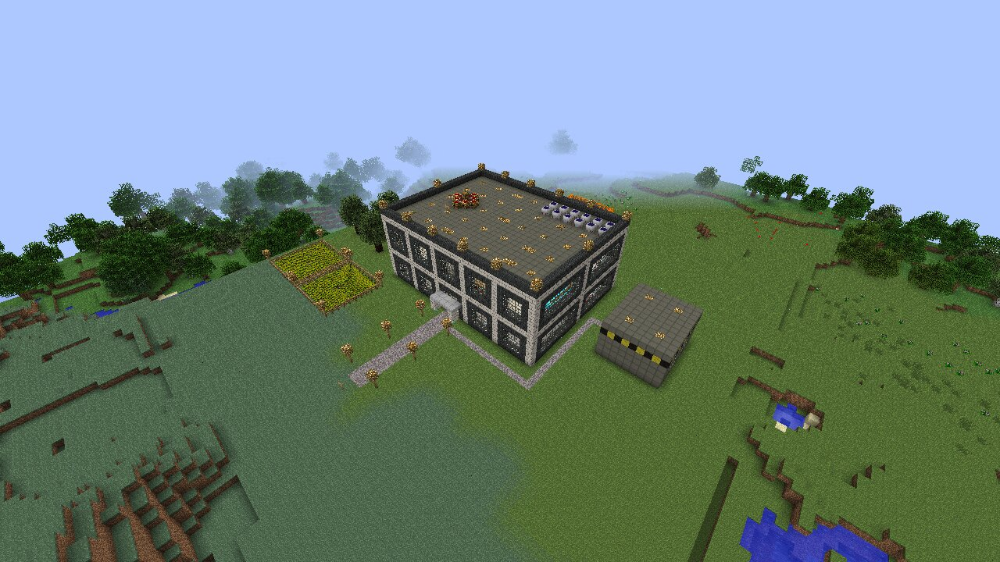

## Install

1. Close the Technic Launcher / Minecraft.
2. Open your Tekkit Classic folder. On Windows, press `Win + R`, paste
   `%APPDATA%\.technic\modpacks\tekkit` and press Enter.
   (In the launcher: *Modpack Options -> Open*.)
3. Open the `saves` folder (create it if it isn't there).
4. Extract `TekkitTechBase.zip` there, so you get `saves\TekkitTechBase\level.dat`.
5. Start Tekkit Classic, go to *Singleplayer* and choose **Tekkit Tech Base**.

You spawn in survival on the path in front of the base, looking at it. Grab the
**Starter Kit** chest just inside the front door.

## What's in the base

**Floor 1: machine hall**
- 20 IndustrialCraft 2 machines in two rows: macerators, electric furnaces,
  extractors, compressors, recyclers, a canning machine, and the Advanced
  Machines (rotary macerator, singularity compressor, centrifuge extractor).
  Most of them are already working on ores and dusts.
- Power room: 4 MFSUs (charged to about 10M EU each), an MV and an LV transformer, an
  induction furnace, a mass fabricator fed with scrap, and a Mk3 charging bench.
- Workshop: crafting tables, a RedPower project table and alloy furnace,
  furnaces, an iron furnace and supply chests.

**Floor 2**
- Storage vault: 48 diamond chests. 18 are labelled and full: ores, ingots,
  gems, dusts, circuits, cables, machines, cells and batteries, BuildCraft,
  RedPower, building blocks, bulk stone, mob drops, nether, farm, alchemy,
  computers, and wireless/misc. The other 30 are empty for your own loot.
- EE lab: a transmutation tablet, alchemical chests full of EE materials, dark
  and red matter furnaces, a pedestal, and DM/RM blocks with interdiction torches.
- Quarters: bed, food, bookshelves, and an armory. The armory has a charged
  quantum suit and nano suit, a mining laser, drills, a chainsaw, a nano saber,
  a jetpack, a lappack, dark and red matter tools and armor, and EE rings.
- A ComputerCraft computer that prints a guide to the base. Right-click it.

**Roof:** 12 high-voltage solar arrays (512 EU/t each) feeding the MFSUs, and an
EMC farm: 8 Energy Collectors MK3 and 4 Antimatter Relays MK3 feeding an Energy
Condenser set to make diamonds. They drop into the chest on top of it.

**Outside**
- **Quarry** (north): an 11x11 BuildCraft quarry with its frame already built,
  three redstone engines and gold/stone pipes that carry its output into a
  diamond chest inside the hall. **Flip both levers to start it.**
- **Reactor bunker** (east): a reinforced-stone bunker with a nuclear reactor
  and 5 reactor chambers, plus a chest of uranium cells, coolant cells and
  plating. **The reactor is empty on purpose.** Design a safe cooling layout
  before you add uranium, or it will explode.
- Wheat farms, IC2 rubber trees, a lit nether portal, a gravel path with lamp posts.

## How the power works

```
12x HV Solar Array (roof) --glass fibre--> 4x MFSU
MFSU A --> MV transformer --> induction furnace (128 EU/t)
                           \-> LV transformer --> under-floor glass fibre --> 20 LV machines (32 EU/t)
MFSU B --> mass fabricator (512 EU/t)
MFSU C --> charging bench Mk3
```

Each tier only touches machines that can take its voltage, so nothing explodes.
The LV bus uses glass fibre because IC2 1.97 splits power across every
machine and rounds down after cable loss. Over a long copper cable, the
machines at the far end would get nothing.

## How it was made and checked

`build.py` writes the base into a world generated by the real Tekkit Classic
3.1.2 server, so the terrain, ores and rubber trees are normal Tekkit worldgen.

- The block IDs, tile-entity IDs and NBT layouts come from the Tekkit Classic
  configs and the decompiled mod code. Item IDs come from `data/items.tsv`,
  which a small Bukkit plugin (`tools/Dumper.java`) dumped from the running server.
- The world was loaded on the Tekkit server and run for several minutes:
  - Every tile entity loaded and saved again.
  - The solar arrays filled the MFSUs and every machine was powered.
  - The mass fabricator and EMC condenser ran.
  - Nothing exploded.
- The screenshots below come from the real Tekkit Classic client (Forge
  3.3.8.164, OptiFine, 41 mods) loading this world.

To rebuild: generate a world with the Tekkit server (seed `42424242`, spawn
near x=200 z=290), then run `python3 build.py <generated-world> <output-world>`.

## Screenshots

| | |
|---|---|
| 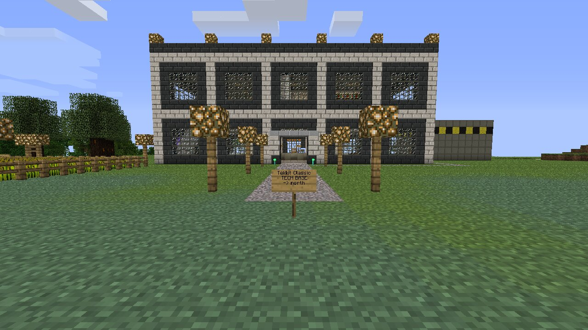 | 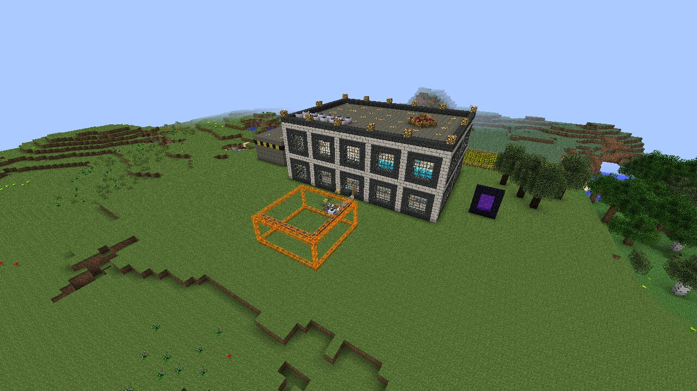 |
| 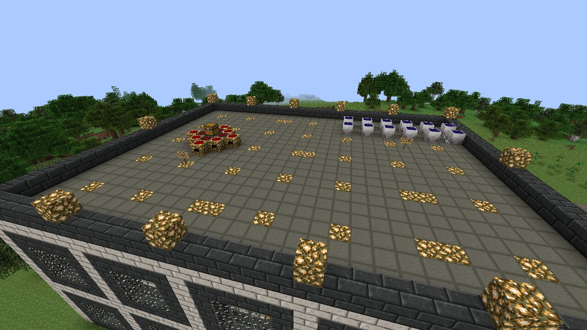 | 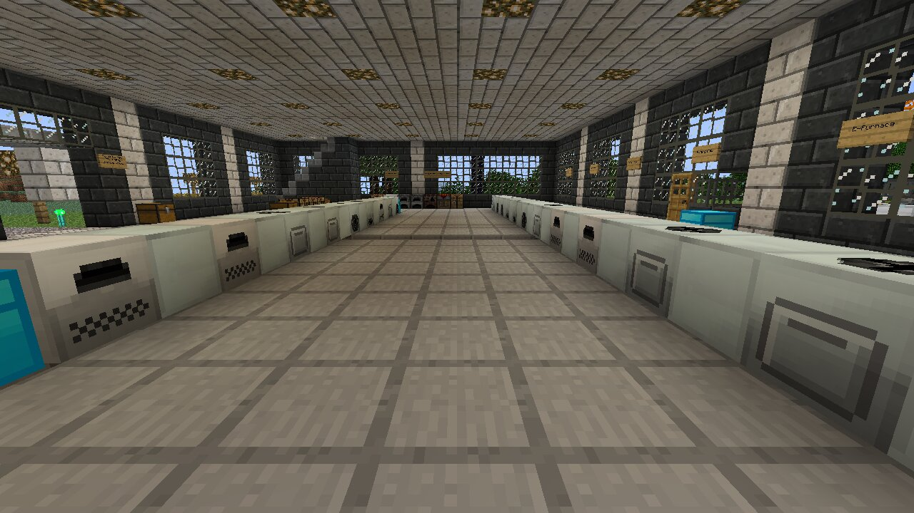 |
| 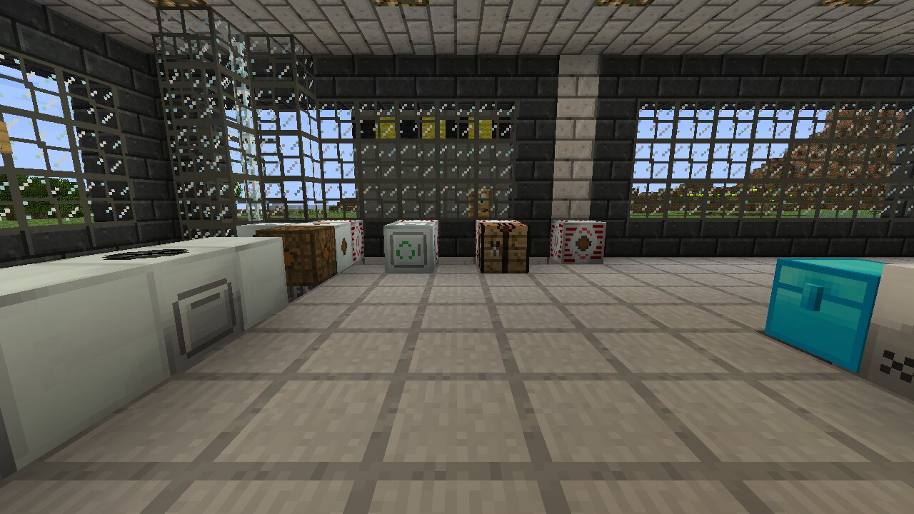 | 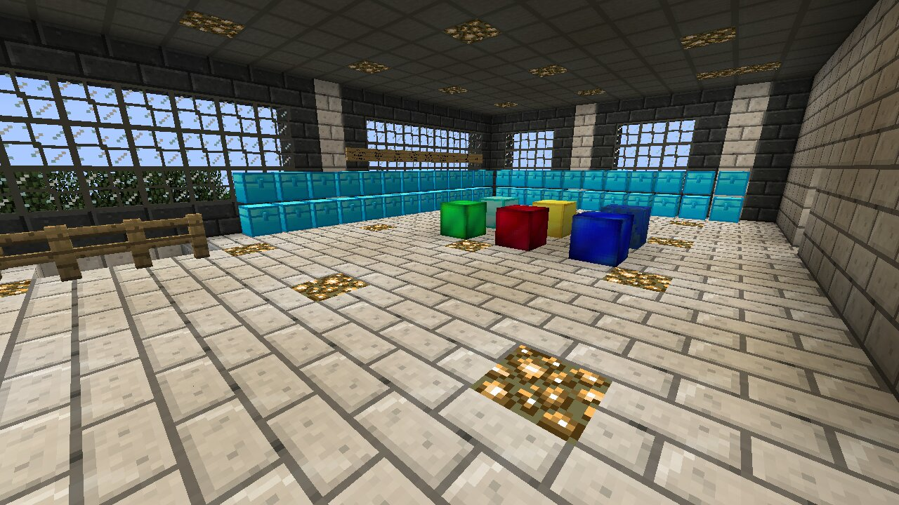 |
| 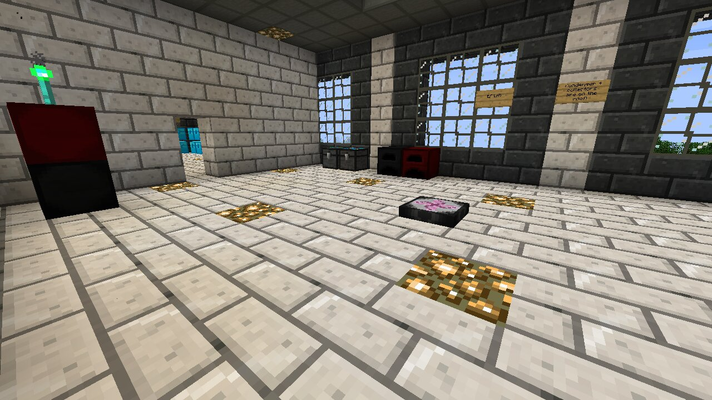 | 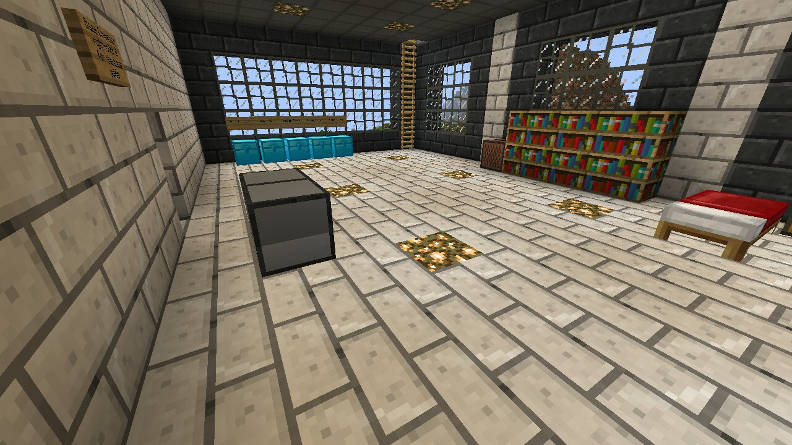 |
| 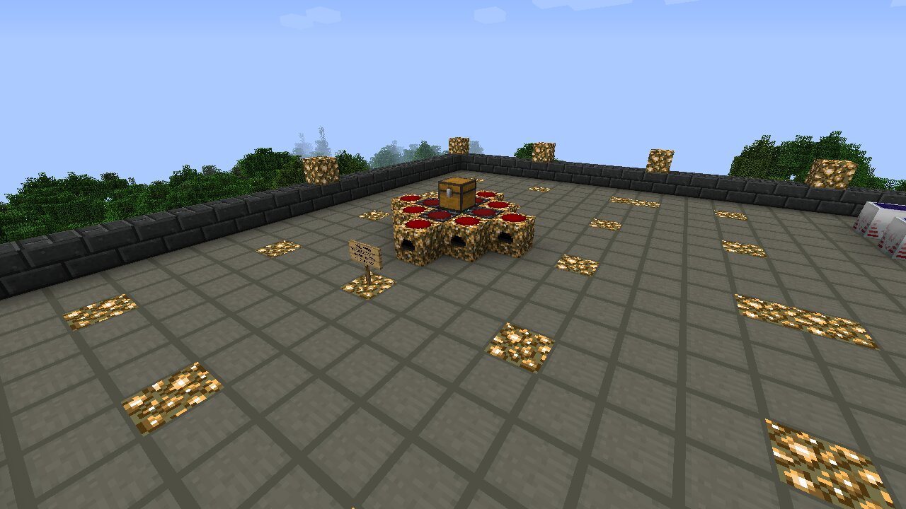 | 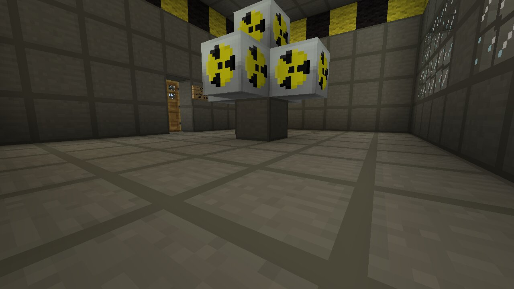 |
| 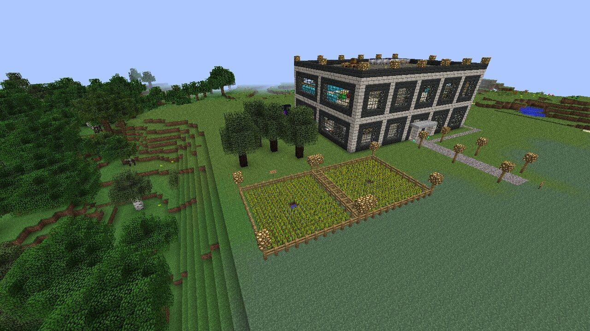 | |
